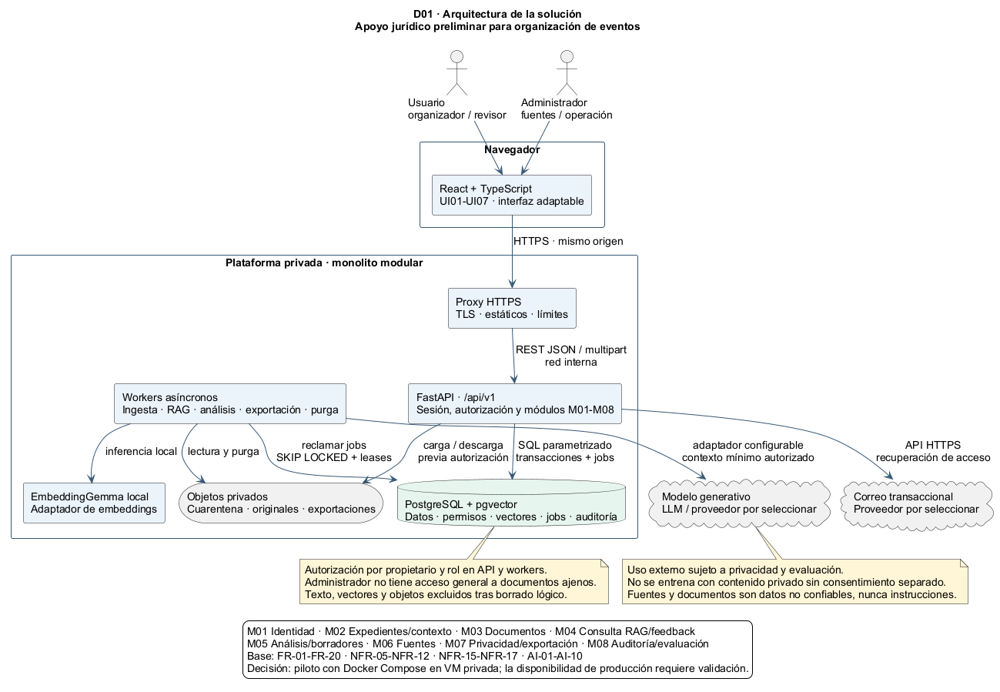
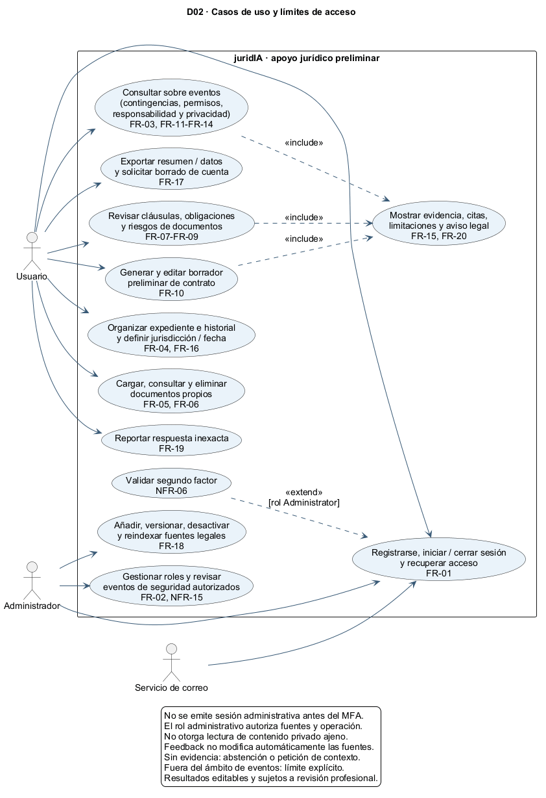
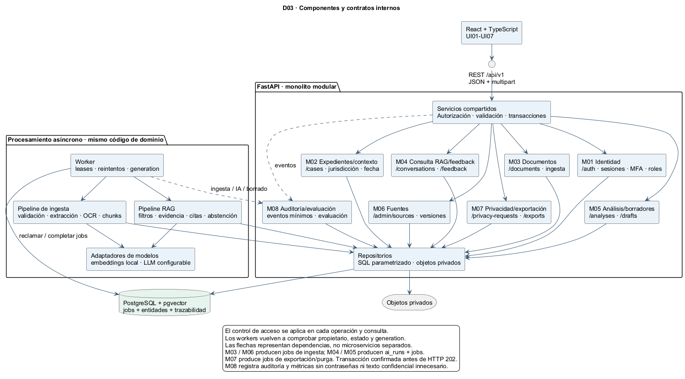
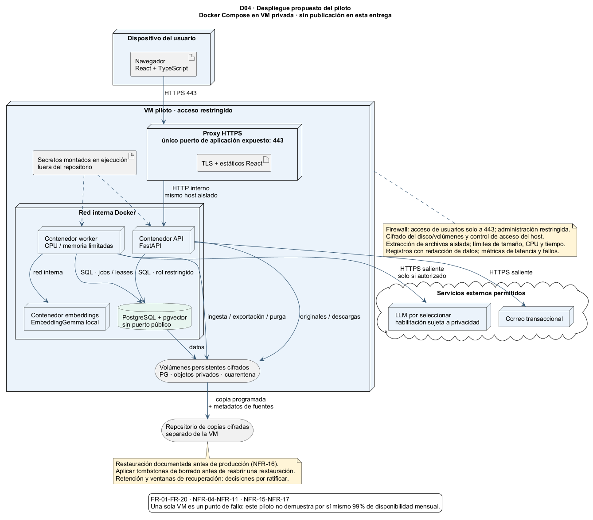
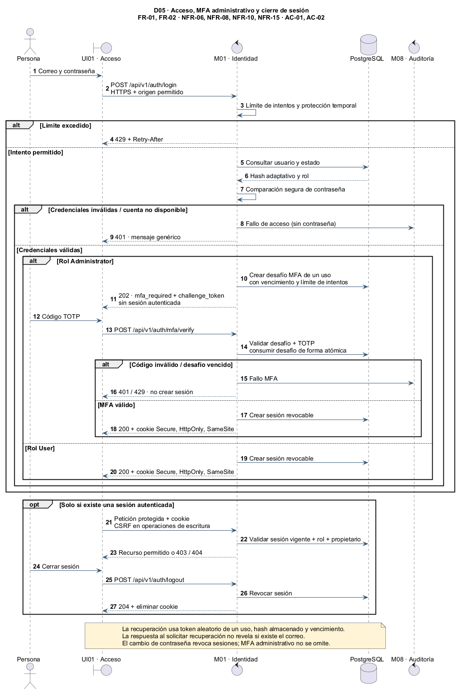
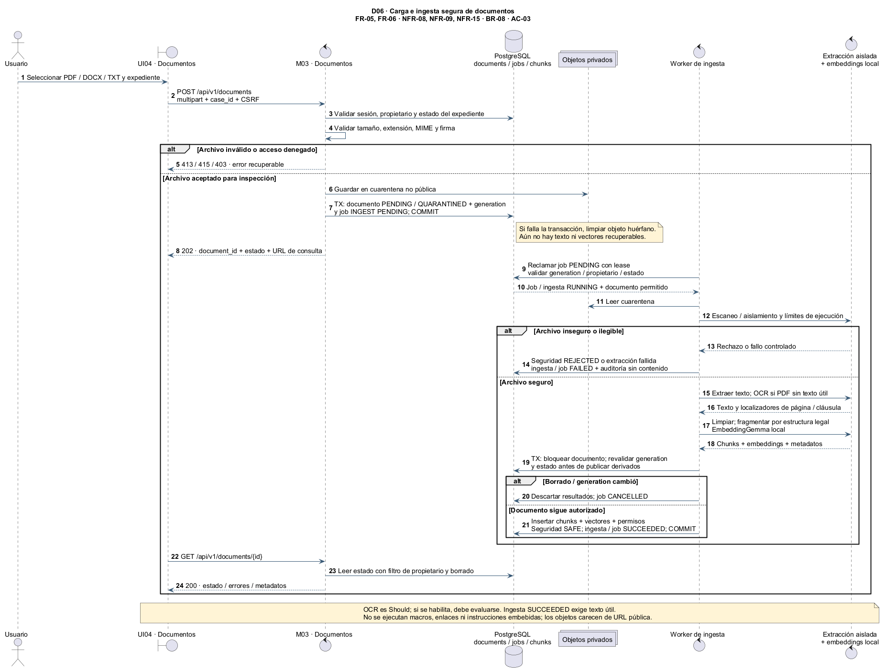
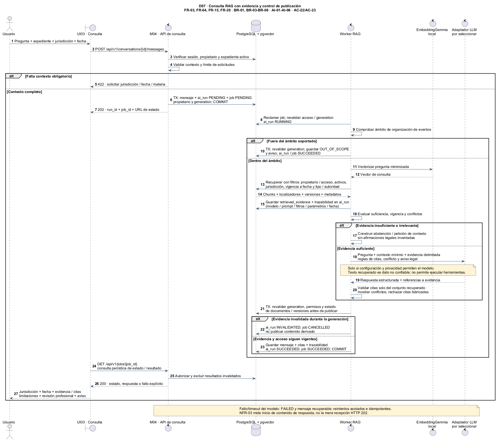
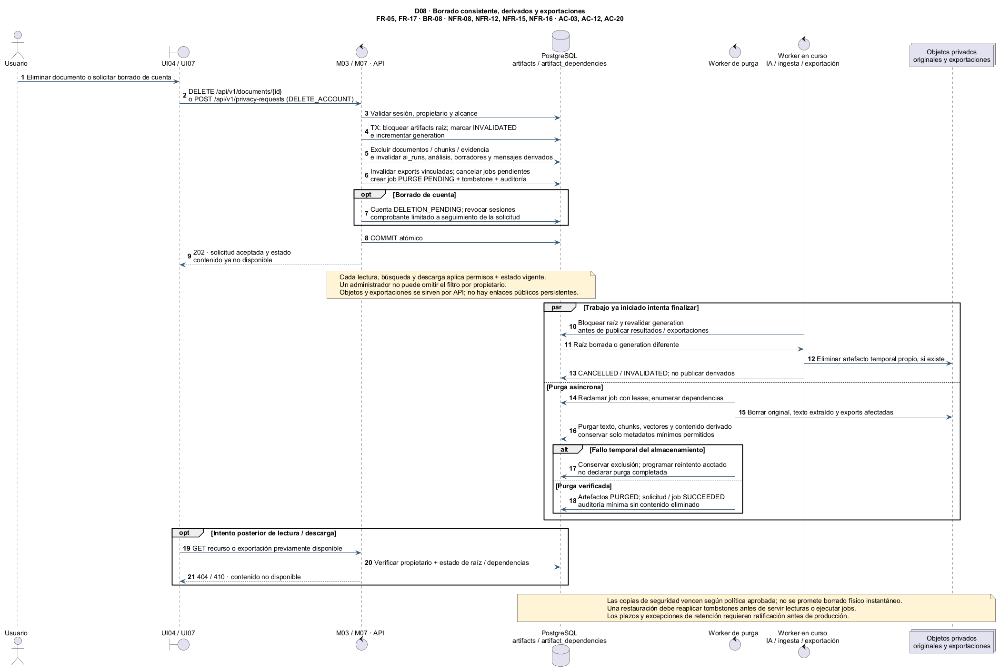

## 5. Diagramas de diseño

Las vistas D01–D09 describen la solución propuesta desde perspectivas complementarias: estructura, funciones, despliegue, interacción y persistencia. Se incluyen cuatro secuencias para procesos críticos: acceso, ingesta, consulta y borrado. Los diagramas son especificaciones previas a implementación; no representan infraestructura instalada ni pruebas ejecutadas.

Cada figura se acompaña de su versión vectorial ampliable y su fuente PlantUML editable. Los identificadores M01–M08 remiten a los módulos de la sección 4; UI01–UI07, a las pantallas de la sección 6. Las flechas de componentes representan dependencias, mientras que las de secuencia ordenan mensajes. `alt`, `opt` y `par` indican alternativas, pasos opcionales y concurrencia, respectivamente; `TX` y `COMMIT` delimitan cambios transaccionales.

### 5.1 D01. Arquitectura general

[Ampliar D01 en SVG](../diagramas/D01-arquitectura.svg) · [Fuente PlantUML](../diagramas/D01-arquitectura.puml).

La vista sitúa al usuario y al administrador frente a una misma aplicación web. El proxy recibe las conexiones HTTPS y las dirige a la API; la base reúne relaciones, vectores y trabajos persistentes. Los binarios permanecen en almacenamiento privado. El worker realiza ingesta, recuperación y generación, análisis, exportación y purga sin mantener abierta una petición web durante todo el procesamiento.

La decisión central es un monolito modular con procesamiento asíncrono: permite compartir reglas de autorización y transacciones entre módulos, manteniendo separadas sus responsabilidades. EmbeddingGemma se ejecuta localmente; la generación se integra mediante un adaptador y un modelo aún por seleccionar. El contexto enviado al generador se limita a información autorizada y su habilitación depende de las condiciones de privacidad. El rol administrativo no concede lectura general de documentos ajenos.

### 5.2 D02. Casos de uso y actores

[Ampliar D02 en SVG](../diagramas/D02-casos-uso.svg) · [Fuente PlantUML](../diagramas/D02-casos-uso.puml).

El usuario organiza expedientes, carga documentos, consulta información, revisa hallazgos, prepara borradores y ejerce sus opciones de exportación y borrado. El administrador mantiene las fuentes jurídicas y realiza las operaciones que su rol permita. El servicio de correo participa en la recuperación de acceso. Las asociaciones identifican funciones y actores; el detalle de permisos por recurso se define en seguridad y API.

Las relaciones `include` hacen explícita la presentación de evidencia, límites y aviso en consultas, análisis y borradores. La relación `extend` de MFA está condicionada al acceso administrativo: bajo esa condición, el segundo factor es obligatorio antes de emitir una sesión completa. Las respuestas fuera de alcance o sin evidencia tienen una salida explícita. La presencia de OCR, historial o comentarios en la vista conserva sus prioridades Should originales.

### 5.3 D03. Componentes y contratos internos

[Ampliar D03 en SVG](../diagramas/D03-componentes.svg) · [Fuente PlantUML](../diagramas/D03-componentes.puml).

La API expone contratos bajo `/api/v1`; los servicios compartidos aplican autorización, validación y límites transaccionales. Los repositorios centralizan el acceso a base y objetos privados. Ingesta y RAG utilizan adaptadores de modelos y el mismo código de dominio que la aplicación. Esta separación permite sustituir una integración sin cambiar las reglas de propiedad o evidencia.

Los módulos crean trabajos persistentes y confirman la transacción antes de responder HTTP 202. El worker reclama cada trabajo con un arrendamiento temporal, aplica reintentos limitados y vuelve a comprobar propietario, disponibilidad y `generation`. Ese contador cambia al invalidar un artefacto y evita publicar resultados calculados sobre una versión ya retirada. M08 recibe eventos mínimos de API y workers; no necesita copiar el contenido completo de los documentos para registrar una operación.

### 5.4 D04. Despliegue del piloto

[Ampliar D04 en SVG](../diagramas/D04-despliegue.svg) · [Fuente PlantUML](../diagramas/D04-despliegue.puml).

Se propone una VM con Docker Compose. El proxy es el punto público de acceso a la aplicación por el puerto 443; API, workers, embeddings y PostgreSQL se comunican en la red interna. Los secretos se incorporan durante la ejecución y los datos persistentes utilizan volúmenes cifrados. Los extractores requieren aislamiento y límites de recursos porque procesan archivos no confiables.

La separación de las copias respecto de la VM reduce la dependencia del disco del host para recuperar datos. Su restauración debe ensayarse y reaplicar los registros de eliminación antes de habilitar lecturas o trabajos. Un host único sigue siendo un punto de fallo: la figura no demuestra el objetivo mensual de disponibilidad de NFR-04. Proveedor, capacidad, conservación y ventanas de recuperación permanecen sujetos a las decisiones y verificaciones de las secciones 12, 14 y 18.

### 5.5 D05. Acceso, MFA y cierre de sesión

[Ampliar D05 en SVG](../diagramas/D05-secuencia-acceso-mfa.svg) · [Fuente PlantUML](../diagramas/D05-secuencia-acceso-mfa.puml).

La secuencia comienza verificando límites de intentos y credenciales. Para el administrador, la primera respuesta válida entrega un desafío temporal de un uso, sin sesión autenticada. Solo la validación y el consumo atómico del desafío permiten crear una sesión revocable. Las operaciones posteriores comprueban sesión, rol y propietario; las escrituras incluyen protección CSRF.

Se distinguen credenciales inválidas, desafío vencido y exceso de intentos mediante respuestas controladas, sin revelar secretos. Cerrar sesión revoca el registro del servidor y elimina la cookie. La recuperación anotada en el diagrama utiliza un token de un uso; cambiar la contraseña revoca sesiones y mantiene la exigencia de MFA.

### 5.6 D06. Ingesta segura de documentos

[Ampliar D06 en SVG](../diagramas/D06-secuencia-ingesta.svg) · [Fuente PlantUML](../diagramas/D06-secuencia-ingesta.puml).

La API valida acceso, tamaño y formato real antes de aceptar el archivo en cuarentena. Registra documento y trabajo en una transacción; HTTP 202 confirma la aceptación para procesamiento. El worker inspecciona el archivo, extrae texto con localizadores y genera fragmentos y vectores. Únicamente un documento seguro, con texto útil y procesamiento concluido, puede incorporarse a la recuperación.

El flujo contempla archivos inseguros o ilegibles y la limpieza de un objeto huérfano si falla la transacción inicial. Antes de publicar fragmentos se bloquea y revalida el documento: si fue eliminado o cambió su generación, el trabajo se cancela. OCR sigue siendo Should; cuando no esté habilitado, un PDF sin texto útil debe mostrar esa limitación y no producir una ingesta vacía exitosa.

### 5.7 D07. Consulta RAG y evidencia

[Ampliar D07 en SVG](../diagramas/D07-secuencia-consulta-rag.svg) · [Fuente PlantUML](../diagramas/D07-secuencia-consulta-rag.puml).

La consulta exige autorización y contexto suficiente. Tras persistir mensaje, ejecución y trabajo, el worker comprueba el ámbito y recupera fragmentos con filtros de acceso, disponibilidad, jurisdicción y aplicabilidad temporal. Registra la evidencia efectivamente recuperada junto con versiones y parámetros. El modelo recibe evidencia delimitada como datos, sin facultad para ejecutar instrucciones contenidas en ella.

La falta de contexto solicita corrección; una pregunta fuera del ámbito recibe un límite explícito; la evidencia insuficiente produce abstención. Si se genera una respuesta, sus referencias deben pertenecer al conjunto recuperado. Antes de publicarla se revisan nuevamente permisos y estado de sus entradas: una eliminación concurrente invalida la salida. La procedencia de una cita no demuestra por sí sola su respaldo semántico, cuya evaluación se define en la sección 13.

La figura representa consulta periódica del estado; el canal SSE previsto en la arquitectura debe conservar los mismos controles de acceso y publicación. Ni HTTP 202 ni un evento de progreso satisfacen el inicio de respuesta útil de NFR-03. Ante un fallo del modelo se registra el error y se permite recuperación acotada, sin fabricar una respuesta sustitutiva.

### 5.8 D08. Borrado, derivados y exportaciones

[Ampliar D08 en SVG](../diagramas/D08-secuencia-borrado-exportaciones.svg) · [Fuente PlantUML](../diagramas/D08-secuencia-borrado-exportaciones.puml).

La eliminación invalida el artefacto raíz y sus derivados mediante `artifact_dependencies`, incrementa su generación, bloquea exportaciones y registra la purga en una misma transacción. Una vez aceptada la solicitud, las rutas de lectura, recuperación y descarga deben excluir el contenido afectado. Para borrar una cuenta también se revocan sus sesiones y se ofrece un comprobante de seguimiento de alcance limitado.

El bloque paralelo muestra el caso crítico de un worker que intenta terminar mientras otro purga datos. La comprobación de generación impide publicar el resultado obsoleto; la purga elimina originales y contenido derivado según la política aplicable. Si falla el almacenamiento, permanece la inaccesibilidad y se reintenta sin declarar la eliminación completa. Las copias siguen su política de conservación y los registros de eliminación se reaplican tras restaurar.

### 5.9 Relación con datos y trazabilidad

D09, presentado en la sección 9, completa estas vistas con entidades, claves y cardinalidades: [modelo en SVG](../diagramas/D09-modelo-datos.svg) y [fuente PlantUML](../diagramas/D09-modelo-datos.puml). `jobs` materializa el trabajo asíncrono; `artifacts` y sus dependencias sostienen D08; `retrieved_evidence` y `citations` permiten reconstruir la evidencia de D07. El diccionario de la sección 8 precisa atributos y restricciones que no caben en las figuras.

| Diagrama | Responsabilidad que permite revisar | Referencias principales |
|---|---|---|
| D01 | Distribución general y fronteras de confianza | FR-01–FR-20; NFR-05, NFR-08, NFR-12 |
| D02 | Actores, funciones y límites del producto | FR-01–FR-20; NFR-06; BR-01, BR-02 |
| D03 | Asignación de módulos y controles compartidos | NFR-08, NFR-15, NFR-17; AC-18, AC-20 |
| D04 | Transporte, almacenamiento y recuperación | NFR-04–NFR-07, NFR-11, NFR-16; AC-16, AC-19 |
| D05 | Sesiones, MFA y autorización | FR-01, FR-02; NFR-06, NFR-08, NFR-10; AC-01, AC-02 |
| D06 | Ingesta y exclusión de contenido inseguro | FR-05, FR-06; NFR-09; AC-03 |
| D07 | Contexto, evidencia, citas y abstención | FR-03, FR-04, FR-15, FR-20; AI-01–AI-08; AC-04, AC-08, AC-21–AC-23 |
| D08 | Eliminación coherente de originales y derivados | FR-05, FR-17; BR-08; NFR-12; AC-03, AC-12, AC-20 |
| D09 | Integridad, propiedad y persistencia del diseño | FR-01–FR-20; NFR-08, NFR-12, NFR-15 |

La matriz completa de la sección 16 conecta cada requisito con módulo, interfaz, datos, API, diagrama y verificación prevista. Las referencias AI-09 y AI-10 que aparecen en leyendas de D01 y D07 provienen de la brecha de la especificación descrita en la sección 1.4: el diseño de registro y evaluación se sustenta en AC-22 y AC-23, sin dar por formalizados dos requisitos adicionales.
