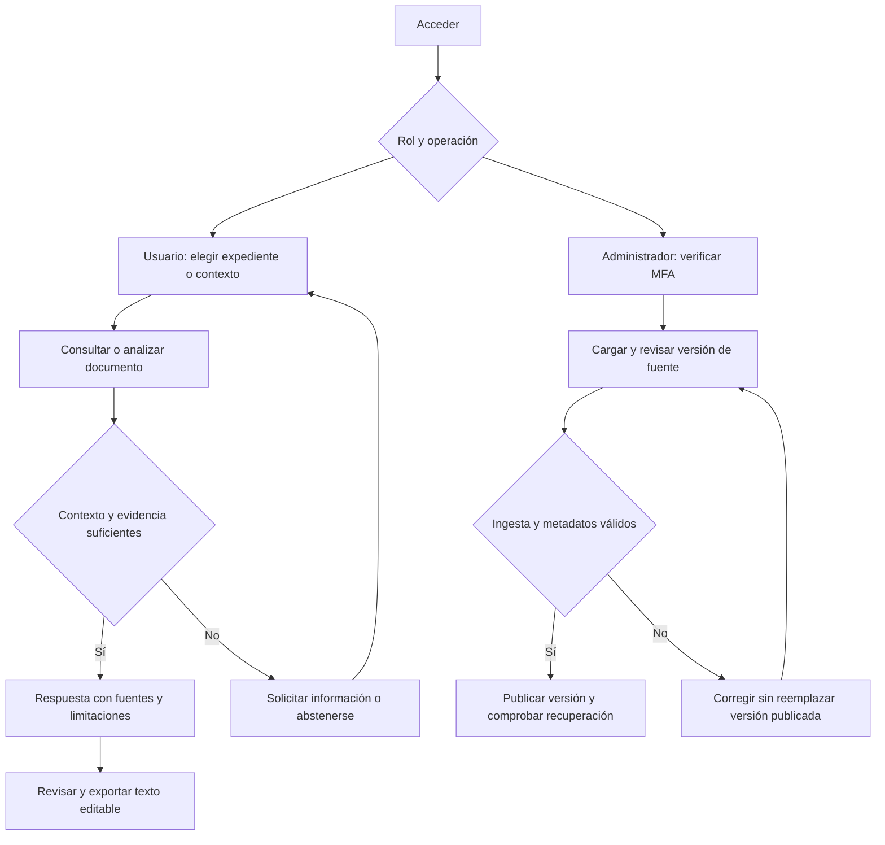

## 6. Diseño preliminar de interfaces

Los siguientes mockups visuales estáticos y bocetos textuales definen contenido, acciones y estados antes de programar. No constituyen una aplicación funcional. Las siete vistas SVG usan datos vacíos o ejemplos ficticios marcados e incluyen variantes de carga, vacío, error y éxito para revisión del diseño. Se pueden regenerar con `python scripts/generar_interfaces.py` desde la raíz del proyecto.

### UI01. Acceso y recuperación


```text
juridIA | Apoyo jurídico preliminar para eventos
Correo       [____________________________]
Contraseña   [____________________________]
[ Entrar ]   Crear cuenta   Recuperar acceso
Error: mensaje junto al campo correspondiente
Administrador: código MFA [______] [Verificar]
```

Propósito: crear una cuenta o iniciar una sesión. Acciones: registrarse, ingresar, recuperar acceso y completar MFA. Datos: correo, contraseña y desafío temporal; nunca se muestran hashes ni tokens. El registro público crea únicamente cuentas Usuario. Requisitos: FR-01, FR-02 y NFR-06.

### UI02. Expedientes y contexto del evento


```text
Expedientes | Documentos | Cuenta              [Salir]
Mis eventos                       [Crear expediente]
Nombre             Jurisdicción       Fecha    [Abrir]
----------------------------------------------------
Evento [________]   País [____]   Región [____]
Localidad [____]    Materia [____] Fecha [____]
Contexto [___________________________________]
[Guardar] [Consultar] [Documentos] [Borradores]
```

Propósito: reunir el contexto que necesita una consulta. Acciones: crear, buscar, abrir y modificar expedientes propios. Datos: nombre, ubicación, materia, fecha y contexto. Cambiar un expediente no modifica el contexto histórico de respuestas previas. La localidad se solicita cuando sea necesaria para identificar el ámbito de una obligación. Requisitos: FR-04 y FR-16.

### UI03. Consulta y fuentes


```text
Evento seleccionado | Jurisdicción | Fecha [Cambiar]
Pregunta: [_______________________________________]
Documentos propios [Seleccionar]          [Consultar]
----------------------------------------------------
Respuesta preliminar
Información respaldada [1] [2]
Fuentes: título, versión, fecha, artículo si existe
[Ver pasaje]  Limitaciones / Conflictos / Revisión
[Exportar resumen editable] [Reportar respuesta]
Aviso: apoyo informativo; requiere revisión profesional
```

Propósito: consultar y comprobar el respaldo. Acciones: formular pregunta, seleccionar documentos, abrir pasajes, exportar y reportar. Datos: respuesta, contexto usado, citas y límites. Si falta evidencia, la pantalla muestra la abstención y explica qué información falta. Las referencias privadas se distinguen de las fuentes jurídicas del corpus. Reportar permite seleccionar expresamente el fragmento que será visible para revisión administrativa. Requisitos: FR-03, FR-04, FR-11 a FR-15, FR-17, FR-19, FR-20; BR-03, BR-04 y BR-06.

### UI04. Documentos y análisis


```text
[Subir PDF / DOCX / TXT]            Filtrar expediente
Archivo           Estado            [Abrir] [Eliminar]
contrato.pdf      En análisis
----------------------------------------------------
Texto con localizadores | Cláusulas / Obligaciones
                        | Fechas / Pagos / Penalidades
                        | Riesgos / Información faltante
[Analizar]              | [Ver fragmento de origen]
```

Propósito: organizar y analizar documentos. Acciones: subir, abrir, asociar a expediente, analizar y borrar. Datos: estado de ingesta y hallazgos separados por tipo. «No encontrado» no equivale a «no existe». Los posibles riesgos se presentan como cuestiones para revisión, no como dictámenes. Antes de borrar se explican los efectos sobre resultados y exportaciones dependientes. Requisitos: FR-05 a FR-09 y BR-08.

### UI05. Borradores


```text
Tipo de acuerdo [Recinto / Artista / Catering / ...]
Partes [_____________] Condiciones [______________]
Contexto del evento                       [Generar]
BORRADOR PRELIMINAR - REVISIÓN PROFESIONAL REQUERIDA
Editor [_________________________________________]
Fuentes / campos pendientes / limitaciones
[Guardar versión] [Exportar archivo editable]
```

Propósito: preparar cláusulas y acuerdos preliminares. Acciones: elegir tipo, completar datos, generar, editar y exportar. Datos: texto, versión, referencias y campos sin completar. Las ediciones del usuario se distinguen del contenido originalmente generado; el sistema no atribuye respaldo automático a texto añadido manualmente. Requisitos: FR-10, FR-20 y BR-07.

### UI06. Administración de fuentes


```text
Fuentes jurídicas                    [Agregar fuente]
Título | Jurisdicción | Vigencia | Versión | Estado
[Nueva versión] [Reindexar] [Activar] [Retirar]
----------------------------------------------------
Comentarios recibidos: motivo y fragmento compartido
[Revisar] [Registrar resolución]
```

Propósito: mantener el corpus. Acciones: agregar, versionar, validar metadatos, activar, desactivar, retirar y reindexar; atender reportes sin alterar automáticamente fuentes. Datos: fuente y estado de ingesta. Solo se accede con rol administrador y MFA. Requisitos: FR-18, FR-19 y BR-05.

### UI07. Cuenta y privacidad


```text
Mi cuenta
Sesiones activas [Cerrar sesión seleccionada] [Cerrar todas]
[Exportar mis datos] [Solicitar eliminación de cuenta]
Solicitudes: fecha | tipo | estado | [Descargar si disponible]
Conservación: política vigente y efecto del borrado
```

Propósito: controlar acceso y datos propios. Acciones: revocar sesiones, solicitar exportación y solicitar eliminación con reautenticación. Datos: estados y política, sin secretos de otras sesiones. La confirmación distingue exclusión inmediata, purga y rotación de copias. Requisitos: FR-01, FR-17, NFR-12 y BR-09.

### Reglas comunes de presentación

En móvil los paneles se apilan, conservando el flujo principal sin desplazamiento horizontal. Los controles tienen etiquetas, foco visible y navegación por teclado. La información de riesgo no depende solo del color. Los cambios de estado se anuncian sin mover el foco inesperadamente.

El aviso propuesto para consulta, borradores y resúmenes es: «Esta herramienta ofrece apoyo informativo preliminar y no sustituye la asesoría de un profesional del derecho autorizado. Revise el contenido antes de firmar, presentar o tomar una decisión vinculante».

## 7. Navegación y recorridos

**Usuario, consulta:** acceso → expediente o contexto directo → seleccionar documentos propios opcionales → enviar pregunta → completar contexto si falta → leer respuesta o abstención → revisar citas y limitaciones → exportar resumen editable o reportar.

**Usuario, análisis:** acceso → documentos → carga → validación y extracción → listo → solicitar análisis → revisar cláusulas, obligaciones y riesgos por separado → abrir el pasaje correspondiente. Si no hay texto y OCR no está disponible, se solicita una versión legible.

**Usuario, borrador:** expediente → tipo de acuerdo → datos de partes y condiciones → generar → revisar fuentes y campos incompletos → editar → guardar versión → exportar para revisión profesional.

**Administrador:** acceso con MFA → fuentes → nueva fuente o nueva versión → validar metadatos e ingesta → activar → comprobar recuperación → retirar o actualizar cuando proceda. Un fallo de ingesta no sustituye la versión publicada.

**Privacidad:** cuenta o documento → ver consecuencias → confirmar, y reautenticar para cuenta → exclusión del contenido → purga asíncrona → consultar resultado. Una purga fallida conserva la exclusión y produce un reintento controlado.


