## 8. Diccionario de datos

PostgreSQL conserva las relaciones y pgvector los embeddings; los archivos binarios se guardan en almacenamiento privado cifrado. Este diseño corresponde a M01–M08 y FR-01–FR-20. Los nombres siguientes constituyen el vocabulario del esquema y del contrato de API.

### 8.1 Convenciones

En las tablas, `!` significa obligatorio/NOT NULL y `?` opcional/NULL. `u` = UUID; `t` = text; `ts` = timestamptz; `j` = jsonb; `i` = integer; `b` = boolean. Cada tabla tiene `id:u! PK` y `created_at:ts!`, salvo las dos tablas de clave compuesta indicadas. Las FK apuntan al `id` de la tabla nombrada. Los instantes se almacenan en UTC; las fechas jurídicas usan `date`. Los identificadores no autorizan acceso.

`E` representa `PENDING → RUNNING → SUCCEEDED|FAILED|CANCELLED`; `FAILED → PENDING` requiere reintento explícito y deja registro. Los estados de disponibilidad son independientes de la ejecución. Campos de texto privado pueden quedar NULL tras purga; antes, los CHECK condicionados al estado exigen los valores correspondientes. Los tamaños, tiempos de expiración y límites operativos se configuran conforme a las propuestas del diseño y no constituyen nuevos requisitos aprobados.

### 8.2 Entidades y atributos

| Tabla / módulo | Atributos adicionales: tipo y obligatoriedad | Restricciones y finalidad |
|---|---|---|
| `users` / M01 | email:t?; password_hash:t?; role:t!; status:t!; failed_attempts:i!; locked_until:ts? | UNIQUE email normalizado; email/hash exigidos mientras cuenta vigente; role USER/ADMIN; status ACTIVE/LOCKED/DELETION_PENDING/DELETED; contador ≥0. DELETED conserva identificador anónimo, sin credenciales. |
| `sessions` / M01 | user_id:u! FK users; token_hash:t!; csrf_hash:t!; expires_at:ts!; last_seen_at:ts!; reauthenticated_at:ts?; revoked_at:ts?; mfa_at:ts? | UNIQUE token_hash; secreto opaco solo en cookie. ADMIN exige MFA antes de crear una sesión completa. expires_at limita duración absoluta; last_seen_at permite caducidad por inactividad; reauthenticated_at registra la última comprobación explícita de credenciales. |
| `password_reset_tokens` / M01 | user_id:u! FK users; token_hash:t!; expires_at:ts!; consumed_at:ts? | Hash único; uso único y consumo transaccional; restablecer contraseña revoca sesiones, sin desactivar MFA. |
| `mfa_credentials` / M01 | user_id:u! FK users; secret_ciphertext:t!; confirmed_at:ts?; enrollment_required:b!; last_used_step:bigint? | UNIQUE user_id; TOTP propuesto; secreto cifrado con clave externa a BD. Paso temporal consumido atómicamente para evitar reutilización. enrollment_required impide nuevas sesiones completas hasta confirmar enrolamiento o recuperación; no desactiva la obligación MFA. |
| `mfa_challenges` / M01 | user_id:u! FK users; token_hash:t!; purpose:t!; pending_secret_ciphertext:t?; expires_at:ts!; consumed_at:ts?; attempts:i! | LOGIN/ENROLL/RECOVER_ENROLL; hash único; contador ≥0. El secreto pendiente solo existe para enrolamiento, se cifra y se purga al vencer o consumirse el desafío. Un desafío nunca sustituye la sesión completa. |
| `mfa_recovery_codes` / M01 | user_id:u! FK users; token_hash:t!; consumed_at:ts? | Hash único de código aleatorio mostrado una vez; uso único consumido transaccionalmente junto con la creación de RECOVER_ENROLL. Requiere además contraseña y desafío LOGIN válidos. La regeneración tras confirmar TOTP retira todos los códigos anteriores. |
| `cases` / M02 | owner_id:u! FK users; title:t!; country:t!; region:t?; matter:t!; relevant_date:date!; event_context:j!; deleted_at:ts? | Contexto obligatorio antes de responder una cuestión jurídica específica; ausencia regional se explicita o solicita. |
| `artifacts` / transversal | owner_id:u! FK users; kind:t!; state:t!; generation:i!; delete_after:ts? | kind DOCUMENT/MESSAGE/AI_RUN/ANALYSIS/DRAFT/EXPORT; state ACTIVE/INVALIDATED/PURGED; generation >0 aumenta al invalidar. Control persistente de disponibilidad y purga. |
| `artifact_dependencies` / M07 | parent_id:u! FK artifacts; child_id:u! FK artifacts | PK(parent_id,child_id); sin id/created_at; padre = entrada, hijo = derivado; mismo propietario; sin autorrelación ni ciclos. |
| `documents` / M03 | case_id:u! FK cases; artifact_id:u! FK artifacts; job_id:u! FK jobs; filename:t?; media_type:t!; byte_size:bigint!; sha256:t!; object_key:t?; extracted_text:t?; ingestion_state:t!; security_state:t! | artifact_id UNIQUE; tamaño >0; PDF/DOCX/TXT por contenido real; E; security_state QUARANTINED/SAFE/REJECTED. Solo SAFE+SUCCEEDED indexable. |
| `conversations` / M04 | case_id:u! FK cases; title:t!; updated_at:ts! | Propiedad heredada del expediente; conserva historial contextualizado. |
| `messages` / M04 | conversation_id:u! FK conversations; artifact_id:u! FK artifacts; run_id:u? FK ai_runs; role:t!; body:t? | artifact_id UNIQUE; USER/ASSISTANT; run_id UNIQUE y obligatorio para ASSISTANT, NULL para USER; resultado solo visible si artefacto activo y ejecución concluida. |
| `legal_sources` / M06 | title:t!; canonical_url:t!; country:t!; region:t?; document_type:t!; authority_level:t?; status:t! | ACTIVE/INACTIVE/REMOVED; catálogo oficial/curado compartido, separado de documentos privados. URL de referencia validada y mostrada con enlace seguro; no ordena una descarga del servidor. |
| `source_versions` / M06 | source_id:u! FK legal_sources; job_id:u! FK jobs; version_label:t!; effective_from:date?; effective_to:date?; retrieved_at:ts!; retrieved_url:t!; sha256:t!; object_key:t?; status:t!; ingestion_state:t! | UNIQUE(source_id,version_label); fechas coherentes; ACTIVE/HISTORICAL/INACTIVE/REMOVED; E. retrieved_url conserva la referencia canonical_url declarada al cargar el archivo y retrieved_at su recepción. Archivo y procedencia son inmutables; fecha jurídica desconocida se muestra como tal. |
| `chunks` / M03/M06 | document_id:u? FK documents; source_version_id:u? FK source_versions; ordinal:i!; locator:j!; text:t?; embedding:vector(768)?; embedding_model:t!; active:b! | Exactamente una FK de origen; ordinal ≥0; locator guarda página/artículo/cláusula/offsets. Activo exige texto, embedding y origen habilitado. Dimensión 768 es propuesta inicial de EmbeddingGemma, sujeta a validación y migración/reindexación. |
| `ai_runs` / M04/M05 | case_id:u! FK cases; artifact_id:u! FK artifacts; job_id:u! FK jobs; input_message_id:u? FK messages; kind:t!; state:t!; model_version:t!; prompt_version:t!; context_snapshot:j!; retrieval_parameters:j!; outcome:t?; error_code:t? | artifact_id y job_id UNIQUE; kind CHAT/ANALYSIS/DRAFT; E más INVALIDATED; outcome GROUNDED/INSUFFICIENT_EVIDENCE/OUT_OF_SCOPE/CONFLICT. Snapshot incluye jurisdicción, fecha y parámetros reproducibles. |
| `retrieved_evidence` / M04 | run_id:u! FK ai_runs; chunk_id:u! FK chunks; rank:i!; score:double precision!; retrieved_at:ts! | PK(run_id,chunk_id); sin id/created_at; UNIQUE(run_id,rank); rank >0. Inventario inmutable de evidencia efectivamente recuperada. |
| `citations` / M04/M05 | run_id:u!; chunk_id:u!; claim_locator:t!; passage_start:i!; passage_end:i! | FK compuesta(run_id,chunk_id) → retrieved_evidence; offsets válidos dentro del chunk. No se admiten citas propuestas libremente por el modelo. |
| `analyses` / M05 | document_id:u! FK documents; run_id:u! FK ai_runs; artifact_id:u! FK artifacts; findings:j? | run_id/artifact_id UNIQUE; findings validado: cláusulas, partes, obligaciones, fechas, pagos, penalizaciones y riesgos con localizadores y límites. |
| `drafts` / M05 | case_id:u! FK cases; conversation_id:u? FK conversations; run_id:u! FK ai_runs; artifact_id:u! FK artifacts; output_type:t!; agreement_type:t?; body:t?; revision:i!; updated_at:ts! | run_id/artifact_id UNIQUE; revision >0; output_type CONTRACT/CLAUSE/CONSULTATION_SUMMARY/COMPLIANCE_NOTES; agreement_type obligatorio para contratos/cláusulas. Todo resultado editable, preliminar y sujeto a revisión profesional. |
| `feedback` / M04/M08 | user_id:u! FK users; message_id:u! FK messages; category:t!; shared_excerpt:t?; excerpt_start:i!; excerpt_end:i!; shared_at:ts!; comment:t?; status:t!; reviewed_by:u? FK users; reviewed_at:ts?; resolution_note:t? | INACCURATE/OUTDATED/UNCLEAR; OPEN/REVIEWED. Rango no vacío validado sobre respuesta ASSISTANT propia y activa; shared_excerpt obligatorio hasta purga. shared_at registra autorización expresa al enviar. REVIEWED exige fecha y resolución; revisa un ADMIN con MFA, conservando su identificador mientras permita la retención. Nunca cambia fuentes automáticamente. |
| `privacy_requests` / M07 | user_id:u! FK users; job_id:u! FK jobs; kind:t!; state:t!; policy_version:t!; completed_at:ts?; receipt_hash:t?; receipt_expires_at:ts? | job_id y receipt_hash UNIQUE; EXPORT_ACCOUNT/DELETE_ACCOUNT; E; SUCCEEDED exige completed_at. Comprobante limitado a seguimiento tras revocación de sesiones. |
| `exports` / M07 | owner_id:u! FK users; artifact_id:u! FK artifacts; job_id:u! FK jobs; origin_kind:t!; conversation_id:u? FK conversations; draft_id:u? FK drafts; draft_revision:i?; privacy_request_id:u? FK privacy_requests; format:t!; object_key:t?; expires_at:ts!; state:t! | artifact_id/job_id UNIQUE. CONVERSATION_SUMMARY exige conversation_id+draft_id y no privacy_request_id; DRAFT exige solo draft_id; ACCOUNT exige solo privacy_request_id. Resumen/borrador: PDF/DOCX/TXT y draft_revision >0. Cuenta: JSON_ZIP y draft_revision NULL. E más INVALIDATED/EXPIRED. |
| `jobs` / workers | requested_by:u? FK users; kind:t!; state:t!; input_refs:j!; observed_generations:j!; progress:j!; idempotency_key:t?; request_hash:t?; attempts:i!; available_at:ts!; lease_until:ts?; lease_token:u?; error_code:t? | E; referencias sin texto confidencial; generaciones de entradas observadas; progreso por fase; idempotencia por usuario/tipo/clave; contador ≥0. Lease obligatorio en RUNNING; su token impide publicación por worker antiguo. |
| `audit_events` / M08 | actor_id:u? FK users; action:t!; target_type:t!; target_id:u?; request_id:u!; outcome:t!; metadata:j! | Registro append-only con eventos de autenticación, ingestión, fuentes y borrado. target_id es referencia histórica sin FK; sin contraseñas, tokens, prompts ni contenido innecesario. |

### 8.3 Integridad, aislamiento y persistencia

La autorización cruza `case.owner_id`, `artifact.owner_id` y el usuario autenticado en cada operación, incluida recuperación vectorial. Los administradores administran fuentes; el rol no concede lectura general de expedientes privados. FK compuestas o triggers transaccionales impiden cruzar propietarios/expedientes entre documentos, conversaciones, mensajes, ejecuciones y resultados. El CHECK XOR separa físicamente la procedencia privada y oficial de cada chunk. El campo `authority_level` nunca convierte un contrato privado en autoridad jurídica.

Las exportaciones validan las tres combinaciones de `origin_kind` descritas en §8.2. Un resumen exige un borrador `CONSULTATION_SUMMARY` asociado a esa conversación; una exportación DRAFT admite cualquier borrador propio y activo; una exportación ACCOUNT exige una solicitud `EXPORT_ACCOUNT` del mismo propietario. La creación registra `draft_revision` y la generación observada; el worker solo publica si la revisión sigue siendo la solicitada, o falla con conflicto para que se repita la exportación. Editar un borrador invalida sus exportaciones anteriores; siempre se comprueban las dependencias y el aviso profesional antes de descargar.

El fragmento compartido en feedback se calcula en el servidor a partir del rango `[excerpt_start,excerpt_end)` sobre el texto canónico de la respuesta, usando índices de puntos de código Unicode desde cero. Debe coincidir exactamente con `shared_excerpt` enviado en la confirmación; un rango o contenido distinto produce 422. Solo se comparte ese fragmento y el comentario expresamente autorizado. La revisión administrativa devuelve esos campos, categoría, estado, fechas y resolución; no devuelve el cuerpo restante, contexto, documentos ni identificadores que autoricen acceso al expediente. Cada lectura verifica que el mensaje y sus ancestros sigan activos; invalidarlos bloquea el reporte y su purga elimina también el fragmento, comentario y resolución. `reviewed_by` permite SET NULL al anonimizar al revisor, con registro del evento sin datos innecesarios.

Las sesiones vencen por `expires_at` o por la ventana de inactividad aplicada a `last_seen_at`. Los heartbeats SSE y el sondeo automático no renuevan actividad por sí solos. Login y reautenticación actualizan `reauthenticated_at`; para ADMIN también exigen un TOTP válido y actualizan `mfa_at`. La recuperación mediante código consume el código y el desafío de acceso, revoca sesiones, activa `enrollment_required` y crea exclusivamente un desafío RECOVER_ENROLL. Solo confirmar el nuevo TOTP sustituye el secreto, consume el desafío, regenera códigos y permite emitir una sesión completa. Caducar o abandonar el desafío conserva la exigencia MFA; no existe ruta para desactivarla.

Los contenidos conservan referencias normalizadas; JSON se reserva para contexto y resultados variables con esquema validado. Índices B-tree: todas las FK; `(owner_id,created_at)` en cases/artifacts; `(conversation_id,created_at)` en messages; `(state,available_at)` parcial para jobs pendientes; `(source_id,status,effective_from)` en versiones; `(document_id,ordinal)` y `(source_version_id,ordinal)` UNIQUE parciales. UNIQUE parcial de versión ACTIVE por fuente. Tokens y email tienen índices únicos. Dependencias requieren índice inverso `(child_id,parent_id)` además de su PK. Índice HNSW con distancia coseno sobre embeddings activos, acompañado de filtros SQL de permisos, jurisdicción, disponibilidad y fecha; se evalúan resultados y latencia antes de habilitarlo en producción.

Al generar una respuesta/borrador o exportación, la transacción guarda aristas desde todos sus documentos, mensajes y resultados de entrada, incluso cuando solo se usa historial. Los borradores editados conservan esa dependencia. `DELETE document` bloquea el artefacto y sus descendientes, marca INVALIDATED, incrementa generation, desactiva chunks y cancela jobs antes de devolver 202. Un worker elimina binarios/texto/embeddings y archivos de exportación, dejando tombstones mínimos. Ninguna URL pública duradera permite saltarse esa invalidación. Lecturas y workers revalidan todos los ancestros; antes de publicar verifican generación observada y lease, bajo bloqueo transaccional compatible con el borrado.

La eliminación de cuenta aplica el mismo proceso a todo contenido del propietario, incluidos feedback, sesiones y secretos; la política determina retención excepcional y purga de respaldos. Se eliminan filas privadas en orden de FK al vencer su retención; nodos de dependencias conservan únicamente identificadores anónimos. Restauraciones reaplican el registro de borrados antes de habilitar consultas. No se borra una FK de evidencia aún referenciada: primero se invalida el resultado, se purga el texto/vector y se conserva identificador mínimo hasta finalizar su retención. Las FK usan RESTRICT salvo eliminación controlada de auxiliares; auditoría puede anonimizar actor con SET NULL. Cambiar una fuente a histórica no reescribe respuestas pasadas: la consulta conserva versión y fecha, muestra su condición actual y nuevas recuperaciones filtran vigencia.

## 9. Modelo entidad-relación

El diagrama muestra todas las entidades, claves, atributos estructurales y cardinalidades; los tipos, obligatoriedad y restantes atributos se precisan en §8. Cada instancia auxiliar pertenece a exactamente un padre cuando su FK es obligatoria. Las dos relaciones opcionales de chunks son excluyentes. En exports, origin_kind determina las tres combinaciones válidas de referencias; un resumen conserva juntas la conversación y su borrador.

```mermaid
erDiagram
    users {
        uuid id PK
        text email UK
        text password_hash
        text role
        text status
    }
    sessions {
        uuid id PK
        uuid user_id FK
        text token_hash UK
        text csrf_hash
        timestamptz expires_at
        timestamptz last_seen_at
        timestamptz reauthenticated_at
    }
    password_reset_tokens {
        uuid id PK
        uuid user_id FK
        text token_hash UK
        timestamptz consumed_at
    }
    mfa_credentials {
        uuid id PK
        uuid user_id FK,UK
        text secret_ciphertext
        boolean enrollment_required
        bigint last_used_step
    }
    mfa_challenges {
        uuid id PK
        uuid user_id FK
        text token_hash UK
        text purpose
        text pending_secret_ciphertext
    }
    mfa_recovery_codes {
        uuid id PK
        uuid user_id FK
        text token_hash UK
        timestamptz consumed_at
    }
    cases {
        uuid id PK
        uuid owner_id FK
        text country
        text region
        date relevant_date
        jsonb event_context
    }
    artifacts {
        uuid id PK
        uuid owner_id FK
        text kind
        text state
        integer generation
        timestamptz delete_after
    }
    artifact_dependencies {
        uuid parent_id PK,FK
        uuid child_id PK,FK
    }
    documents {
        uuid id PK
        uuid case_id FK
        uuid artifact_id FK,UK
        uuid job_id FK
        text object_key
        text ingestion_state
        text security_state
    }
    conversations {
        uuid id PK
        uuid case_id FK
        text title
    }
    messages {
        uuid id PK
        uuid conversation_id FK
        uuid artifact_id FK,UK
        uuid run_id FK,UK
        text role
        text body
    }
    legal_sources {
        uuid id PK
        text title
        text canonical_url
        text country
        text status
    }
    source_versions {
        uuid id PK
        uuid source_id FK
        uuid job_id FK
        text version_label
        date effective_from
        date effective_to
        text status
        text ingestion_state
    }
    chunks {
        uuid id PK
        uuid document_id FK
        uuid source_version_id FK
        integer ordinal
        jsonb locator
        text text
        vector embedding
        boolean active
    }
    ai_runs {
        uuid id PK
        uuid case_id FK
        uuid artifact_id FK,UK
        uuid job_id FK,UK
        uuid input_message_id FK
        text state
        text model_version
        text prompt_version
        jsonb retrieval_parameters
    }
    retrieved_evidence {
        uuid run_id PK,FK
        uuid chunk_id PK,FK
        integer rank
        float score
    }
    citations {
        uuid id PK
        uuid run_id FK
        uuid chunk_id FK
        text claim_locator
        integer passage_start
        integer passage_end
    }
    analyses {
        uuid id PK
        uuid document_id FK
        uuid run_id FK,UK
        uuid artifact_id FK,UK
        jsonb findings
    }
    drafts {
        uuid id PK
        uuid case_id FK
        uuid conversation_id FK
        uuid run_id FK,UK
        uuid artifact_id FK,UK
        text output_type
        text body
        integer revision
    }
    feedback {
        uuid id PK
        uuid user_id FK
        uuid message_id FK
        text category
        text shared_excerpt
        integer excerpt_start
        integer excerpt_end
        timestamptz shared_at
        text status
        uuid reviewed_by FK
        timestamptz reviewed_at
        text resolution_note
    }
    privacy_requests {
        uuid id PK
        uuid user_id FK
        uuid job_id FK,UK
        text kind
        text state
        text receipt_hash UK
        timestamptz receipt_expires_at
    }
    exports {
        uuid id PK
        uuid owner_id FK
        uuid artifact_id FK,UK
        uuid job_id FK,UK
        text origin_kind
        uuid conversation_id FK
        uuid draft_id FK
        integer draft_revision
        uuid privacy_request_id FK
        text state
        text object_key
    }
    jobs {
        uuid id PK
        uuid requested_by FK
        text kind
        text state
        jsonb input_refs
        jsonb observed_generations
        uuid lease_token
        timestamptz lease_until
    }
    audit_events {
        uuid id PK
        uuid actor_id FK
        text action
        uuid target_id
        uuid request_id
    }
    users ||--o{ sessions : autentica
    users ||--o{ password_reset_tokens : recupera
    users ||--o| mfa_credentials : configura
    users ||--o{ mfa_challenges : verifica
    users ||--o{ mfa_recovery_codes : recupera_mfa
    users ||--o{ cases : posee
    users ||--o{ artifacts : controla
    users ||--o{ feedback : reporta
    users o|--o{ feedback : revisa
    users ||--o{ privacy_requests : solicita
    users ||--o{ exports : descarga
    users o|--o{ jobs : solicita
    users o|--o{ audit_events : actua
    artifacts ||--o{ artifact_dependencies : entrada
    artifacts ||--o{ artifact_dependencies : derivado
    artifacts ||--o| documents : representa
    artifacts ||--o| messages : representa
    artifacts ||--o| ai_runs : representa
    artifacts ||--o| analyses : representa
    artifacts ||--o| drafts : representa
    artifacts ||--o| exports : representa
    cases ||--o{ documents : organiza
    cases ||--o{ conversations : conserva
    cases ||--o{ ai_runs : contextualiza
    cases ||--o{ drafts : contiene
    conversations ||--o{ messages : contiene
    conversations o|--o{ drafts : fundamenta
    conversations o|--o{ exports : resume
    messages o|--o{ ai_runs : pregunta
    ai_runs o|--o| messages : responde
    messages ||--o{ feedback : recibe
    legal_sources ||--o{ source_versions : versiona
    documents o|--o{ chunks : origen_privado
    source_versions o|--o{ chunks : origen_oficial
    ai_runs ||--o{ retrieved_evidence : recupera
    chunks ||--o{ retrieved_evidence : evidencia
    retrieved_evidence ||--o{ citations : respalda
    documents ||--o{ analyses : analiza
    ai_runs ||--o| analyses : produce
    ai_runs ||--o| drafts : produce
    drafts o|--o{ exports : version_editable
    privacy_requests o|--o{ exports : exporta
    jobs ||--o{ documents : ingiere
    jobs ||--o{ source_versions : indexa
    jobs ||--o| ai_runs : ejecuta
    jobs ||--o| privacy_requests : procesa
    jobs ||--o| exports : construye
```



Cada artefacto ACTIVE tiene exactamente un subtipo acorde con `kind`, validado al confirmar la transacción; PURGED puede conservar únicamente el nodo. `ai_runs.kind` determina si produce mensaje, análisis o borrador; una ejecución pendiente todavía no tiene resultado. Las aristas opcionales del diagrama no habilitan combinaciones incompatibles.

## 10. Contrato de API

### 10.1 Reglas comunes

FastAPI expone JSON bajo `/api/v1`; archivos usan multipart y descargas autenticadas. `P` = público; `U` = sesión de usuario con propiedad verificada; `A` = administrador con MFA; `R` = comprobante de seguimiento de una solicitud de borrado, sin acceso a otros recursos. Cookie `__Host-session`: Secure, HttpOnly, SameSite=Lax, Path=/; sin Domain. Solicitudes mutables exigen `X-CSRF-Token` y Origin permitido, también login/registro mediante sesión anónima. Los desafíos MFA no conceden acceso a APIs U/A. Nunca se devuelven hashes, claves de servicio ni secretos persistidos; el alta TOTP y los códigos de recuperación se entregan una sola vez en sus operaciones específicas, con `Cache-Control: no-store`.

UUID identifican recursos. Listados aceptan `cursor` y `limit` validado, con máximo configurable propuesto; respuesta `{items,next_cursor}`. POST costosos y solicitudes de privacidad aceptan `Idempotency-Key`: misma clave/payload devuelve la operación existente; payload diferente produce 409. Un 202 de tarea duradera confirma aceptación persistida junto con job PENDING y `Location`; nunca equivale a una respuesta jurídica iniciada para medir NFR-03. El 202 de acceso MFA indica un desafío limitado, sin crear un job. GET job informa progreso y resultado autorizado. La creación del job y de su recurso ocurre en una sola transacción; workers reclaman con `FOR UPDATE SKIP LOCKED`, lease, reintentos acotados y publicación idempotente.

### 10.2 Operaciones principales

Todas las rutas de esta tabla tienen el prefijo `/api/v1`.

| Método y ruta | Acceso / petición | Respuesta correcta |
|---|---|---|
| GET `/auth/csrf` | P; sin body | 200 token CSRF ligado a cookie anónima/sesión |
| POST `/auth/register` | P; `{email,password}` | 201 usuario USER; rol no seleccionable |
| POST `/auth/login` | P; `{email,password}` | 200 sesión+usuario; o 202 `{mfa_required,challenge_token,purpose}` sin sesión completa |
| POST `/auth/mfa/enroll` | Desafío ENROLL/RECOVER_ENROLL; `{challenge_token}` | 200 secreto TOTP pendiente mostrado una vez; aún sin sesión completa |
| POST `/auth/mfa/verify` | Desafío LOGIN/ENROLL/RECOVER_ENROLL; `{challenge_token,code}` | 200 sesión completa tras TOTP válido; ENROLL/RECOVER_ENROLL confirman secreto y devuelven nuevos códigos de recuperación una sola vez |
| POST `/auth/mfa/recover` | Desafío LOGIN; `{challenge_token,password,recovery_code}` | 202 `{challenge_token,purpose:RECOVER_ENROLL}`; consume código y desafío anteriores, revoca sesiones; requiere nuevo enrolamiento y TOTP antes de emitir sesión |
| POST `/auth/reauthenticate` | U; `{password,mfa_code?}`; ADMIN exige TOTP | 204; actualiza reauthenticated_at y, para ADMIN, mfa_at tras validar credenciales |
| POST `/auth/logout` | U; sin body | 204, revoca sesión y cookie |
| GET `/auth/me`, GET `/auth/sessions` | U | 200 perfil / sesiones sin secretos |
| DELETE `/auth/sessions/{id}` | U, sesión propia | 204 revocación |
| DELETE `/auth/sessions` | U; sin body | 204 revoca todas las sesiones propias, incluida la actual, y elimina cookie |
| POST `/auth/password/forgot` | P; `{email}` | 202 respuesta uniforme; token se entrega por correo, nunca en API |
| POST `/auth/password/reset` | P; `{token,new_password}` | 204 token consumido y sesiones revocadas |
| POST `/cases` | U; `{title,country,region,matter,relevant_date,event_context}` | 201 expediente |
| GET `/cases`, GET `/cases/{id}` | U | 200 lista / detalle |
| PATCH `/cases/{id}` | U; campos modificables del contexto | 200 expediente; ejecuciones previas conservan snapshot |
| POST `/documents` | U; multipart `{case_id,file}` | 202 `{document_id,job_id,ingestion_state:PENDING}` |
| GET `/documents` | U; `case_id` obligatorio | 200 documentos autorizados |
| GET `/documents/{id}`, GET `/documents/{id}/content` | U; metadatos / archivo SAFE | 200 detalle / binario autorizado |
| PATCH `/documents/{id}` | U; `{filename}` | 200 cambio de nombre; organización por expediente al cargar |
| DELETE `/documents/{id}` | U | 202 `{job_id,state:PENDING}`; inaccesible desde aceptación |
| POST `/conversations` | U; `{case_id,title}` | 201 conversación |
| GET `/conversations`, GET `/conversations/{id}` | U; listado filtrado por case_id | 200 lista / detalle con contexto |
| POST `/conversations/{id}/messages` | U; `{text,document_ids}` | 202 `{message_id,run_id,job_id,state:PENDING}` |
| GET `/conversations/{id}/messages` | U | 200 historial, resultados, citas, limitaciones y aviso |
| POST `/conversations/{id}/messages/{message_id}/feedback` | U; `{category,comment?,excerpt_start,excerpt_end,shared_excerpt}`; confirmación expresa de compartir fragmento y comentario | 201 reporte OPEN; valida rango y texto de mensaje ASSISTANT propio, registra shared_at |
| POST `/documents/{id}/analyses` | U; `{types:[clauses,obligations,risks]}` | 202 `{run_id,job_id,state:PENDING}` |
| GET `/documents/{id}/analyses`, GET `/analyses/{id}` | U | 200 lista / hallazgos con evidencia |
| POST `/drafts` | U; `{case_id,output_type,conversation_id?,agreement_type?,parties?,terms?,document_ids}` | 202 `{run_id,job_id,state:PENDING}`; genera contrato, cláusula, resumen o sugerencias editables |
| GET `/drafts`, GET `/drafts/{id}` | U; listado por case_id | 200 lista / texto editable y ETag de revisión |
| PATCH `/drafts/{id}` | U; `{body}`, cabecera If-Match | 200 borrador, revisión+1 y ETag nuevo; invalida exportaciones de la revisión anterior |
| POST `/conversations/{id}/exports` | U; `{format:PDF/DOCX/TXT,draft_id,draft_revision}`; resumen editable propio asociado a esa conversación | 202 `{export_id,job_id,state:PENDING}`; origin_kind=CONVERSATION_SUMMARY |
| POST `/drafts/{id}/exports` | U; `{format:PDF/DOCX/TXT,draft_revision}` | 202 `{export_id,job_id,state:PENDING}`; origin_kind=DRAFT |
| GET `/exports/{id}/download` | U; propietario y dependencias activas | 200 archivo; 409 pendiente, 410 invalidado/expirado |
| POST `/privacy-requests` | U; `{kind:EXPORT_ACCOUNT\|DELETE_ACCOUNT}`; DELETE exige reautenticación reciente y MFA admin | 202 `{request_id,job_id,state:PENDING}`; EXPORT produce exportación ACCOUNT/JSON_ZIP; DELETE añade receipt y receipt_expires_at una sola vez, y revoca sesiones |
| GET `/privacy-requests/{id}` | U: propietario; o R: cabecera `Authorization: Receipt <token>` solo para su DELETE_ACCOUNT | 200 estado, política y limitaciones; export_id solo con U y EXPORT_ACCOUNT; R nunca expone contenido ni enlaces de descarga |
| GET `/jobs/{id}` | U/A; propietario/ámbito administrativo | 200 `{state,progress,result,error_code}` |
| GET `/jobs/{id}/events` | U/A; misma autorización y disponibilidad que GET job; `Last-Event-ID` opcional | 200 `text/event-stream`; snapshot vigente, progreso y referencias de resultado validadas; nunca texto sensible antiguo |
| GET `/admin/feedback`, GET `/admin/feedback/{id}` | A; listado filtrable por status; reporte y dependencias activos | 200 categoría, fragmento y comentario compartidos, estado y metadatos de revisión; sin conversación completa |
| PATCH `/admin/feedback/{id}` | A; `{status:REVIEWED,resolution_note}` | 200 revisión; servidor asigna reviewed_by y reviewed_at y audita; no cambia fuentes |
| GET/POST `/admin/sources` | A; crear `{title,canonical_url,country,region,document_type,authority_level}` | 200 catálogo / 201 fuente |
| GET/PATCH/DELETE `/admin/sources/{id}` | A; PATCH `{title,status,authority_level}` | 200 detalle/cambio; 202 retiro lógico y job de purga según política |
| POST `/admin/sources/{id}/versions` | A; multipart `{file,version_label,effective_from?,effective_to?,canonical_url}` | 202 `{version_id,job_id,ingestion_state:PENDING}`; carga administrada en cuarentena; URL solo referencia, sin descarga remota |
| PATCH `/admin/sources/{id}/versions/{version_id}` | A; `{status:ACTIVE/HISTORICAL/INACTIVE}`; versión de esa fuente | 200 versión; ACTIVE exige ingesta SUCCEEDED y validación; publicación atómica pasa la versión activa anterior a HISTORICAL |
| POST `/admin/sources/{id}/reindex` | A; `{version_id}` | 202 job; activa nuevos chunks atómicamente al concluir |

El rol ADMIN se provisiona mediante procedimiento administrativo auditado fuera del registro público. Su primer acceso exige completar MFA. Login emite ENROLL únicamente para el alta inicial sin credencial confirmada; no permite usar esa vía para reemplazar un factor ya configurado. La recuperación exige contraseña, desafío LOGIN y código de recuperación válido, aplica límites y auditoría y concluye únicamente al verificar el TOTP nuevo. Mientras `enrollment_required` esté activo, ningún acceso produce una sesión completa: un nuevo intento de recuperación requiere otro código válido si el desafío anterior venció. Los secretos pendientes y códigos se entregan con prohibición de caché y nunca aparecen en URL, logs o eventos SSE.

Para DELETE_ACCOUNT se propone una ventana de reautenticación de cinco minutos, configurable junto con los tiempos de §11; se comprueban `reauthenticated_at` y, para ADMIN, `mfa_at`. Si falta vigencia se responde 403 `REAUTH_REQUIRED` sin crear solicitud, y la UI dirige a `/auth/reauthenticate`. La aceptación invalida contenido y revoca las sesiones dentro de la transacción. El comprobante opaco de seguimiento R se entrega en esa respuesta, se guarda solo como hash con caducidad y se usa exclusivamente en la cabecera de GET de esa solicitud. No permite acceder a jobs, SSE, exportaciones ni otros recursos, modificar solicitudes o reabrir la cuenta. Su pérdida no vuelve a habilitar la cuenta; su expiración devuelve 401 sin exponer datos. Su duración debe abarcar el plazo de seguimiento de la política y se informa al confirmar el borrado.

La carga de fuentes acepta PDF/DOCX/TXT y aplica los mismos límites, cuarentena y extracción segura que los documentos del usuario. `canonical_url` identifica la procedencia declarada, se conserva como `retrieved_url` de esa versión y no activa peticiones de red. Una versión nueva permanece INACTIVE mientras se ingiere y hasta su publicación explícita; reindexar una versión no la activa ni sustituye su archivo original. Cambiar contenido, procedencia o fechas exige crear otra versión, manteniendo la trazabilidad.

SSE usa la cookie de sesión del mismo origen y comprueba propietario o ámbito administrativo al abrir la conexión y antes de cada emisión. Los tipos son `snapshot`, `progress`, `result` e `invalidated`; incluyen job_id, estado y un identificador de evento para el cliente. `result` comunica únicamente la referencia del recurso que debe leerse mediante GET autorizado; nunca transporta tokens, prompts, cuerpos de mensajes ni pasajes. Una reconexión, con o sin Last-Event-ID, entrega un snapshot recalculado y no reproduce un búfer histórico de contenido. El cliente vuelve a consultar el resultado para obtener su estado actual. Revocar sesión cierra la conexión; invalidar el origen emite solo un aviso mínimo si la sesión aún tiene acceso al estado del job y detiene el flujo. El sondeo GET job es la alternativa cuando se pierde SSE. NFR-03 se mide hasta el primer contenido jurídico validado presentado al usuario tras esa lectura, no hasta un heartbeat, progreso, referencia de resultado o aceptación 202.

### 10.3 Errores y ejemplo

Formato estable: `{error:{code,message,request_id,details}}`; `details` contiene campos inválidos, nunca stack traces, texto confidencial ni existencia de objetos ajenos. Códigos: 400 petición malformada; 401 credenciales/sesión inválidas; 403 rol/MFA/CSRF insuficiente; 404 recurso inexistente o ajeno; 409 conflicto de estado/idempotencia; 410 recurso propio purgado; 412 edición con ETag desactualizado; 413 tamaño excedido; 415 tipo no admitido; 422 contexto incompleto/validación; 429 límite temporal con Retry-After; 503 infraestructura no disponible. Un job aceptado que posteriormente falla conserva `FAILED` y error recuperable; ausencia de evidencia concluye correctamente con `INSUFFICIENT_EVIDENCE`, sin citas inventadas.

Ejemplo ilustrativo de resultado sin evidencia; los UUID no corresponden a datos reales:

```json
{
  "run_id": "7dc41bd8-5e26-4fb2-8152-2a43ea9e0754",
  "state": "SUCCEEDED",
  "outcome": "INSUFFICIENT_EVIDENCE",
  "context": {
    "country": "MX",
    "region": "Puebla",
    "relevant_date": "2026-09-29",
    "matter": "Permisos para evento"
  },
  "answer": "Las fuentes recuperadas no bastan para identificar los permisos aplicables. Indica el municipio y las características del evento.",
  "citations": [],
  "limitations": ["Falta contexto municipal y evidencia suficiente."],
  "requires_professional_review": true,
  "disclaimer": "Apoyo informativo preliminar; no sustituye el asesoramiento de un profesional jurídico autorizado."
}
```

En respuestas respaldadas, cada cita expone nombre de fuente, versión, jurisdicción, vigencia conocida, localizador y pasaje; el servidor los obtiene desde `retrieved_evidence → chunks → source_versions/legal_sources` o identifica expresamente el documento privado. La respuesta del modelo no puede incorporar una referencia ausente de esa relación. Una exportación conserva el aviso y las limitaciones, y vuelve a comprobar disponibilidad antes de descargarse.
