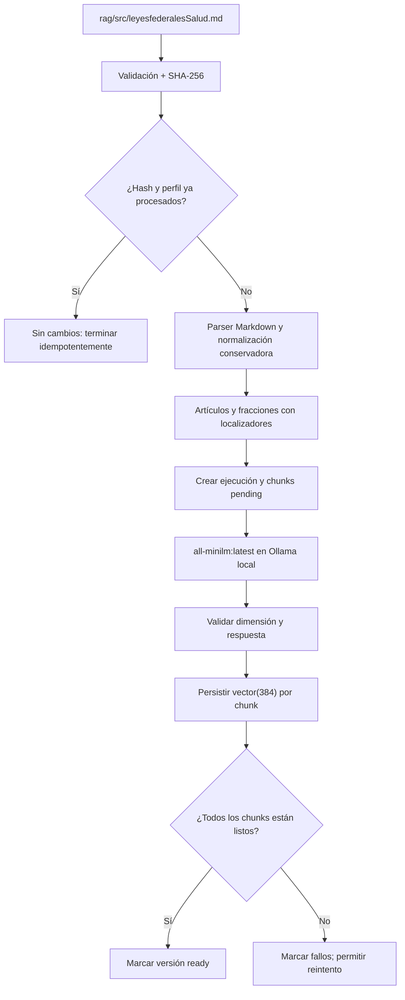

# Arquitectura del pipeline de ingesta RAG

## 1. Objetivo y alcance

Definir la ingesta inicial de `rag/src/leyesfederalesSalud.md` hasta PostgreSQL + pgvector:

1. Validar y versionar la fuente sin modificar el original.
2. Derivar texto limpio de forma conservadora y segmentarlo según su estructura normativa.
3. Generar embeddings localmente con Ollama `all-minilm:latest`.
4. Persistir texto, localizadores, metadatos y vectores para su uso futuro.

Esta fase **no** implementa embeddings de consultas, búsqueda semántica/híbrida, reranking, APIs de consulta ni generación de respuestas. La activación jurídica de la fuente también queda fuera del proceso automático: ingestar no equivale a validar ni publicar una ley.

## 2. Estado actual y decisiones

- El documento canónico es `rag/src/leyesfederalesSalud.md` (Markdown UTF-8, aproximadamente 83 KB). Contiene títulos, capítulos, artículos, fracciones, encabezados repetidos y fragmentos con apariencia de OCR.
- `rag/main.py` está vacío y puede convertirse en el punto de entrada de la CLI.
- `LegalSource` y `SourceVersion` ya existen. `SourceVersion.chunks` y `embedding_json` son placeholders JSON, no un almacenamiento vectorial.
- `backend/scripts/seed_sources.py` todavía busca una copia en la raíz (`leyesfederalesSalud.md`); la ingesta nueva debe tomar `rag/src/` como única ruta canónica y evitar duplicar fuentes.
- En el entorno verificado, `all-minilm:latest` respondió a `/api/embed` con 384 dimensiones. Su metadato local reporta contexto máximo de 512 tokens.
- pgvector está instalado en la base `juridIA`. La conexión debe compartirse con el backend; no se deben guardar credenciales en este documento ni en el repositorio.
- Mantener el original inmutable. La limpieza afecta solo a una representación derivada y debe producir advertencias en vez de eliminar texto dudoso.

## 3. Componentes propuestos

| Componente | Responsabilidad |
|---|---|
| CLI/orquestador (`rag/main.py`) | Resolver la fuente y el manifiesto, ejecutar etapas, ofrecer modo de previsualización, resumir resultados y establecer el código de salida. |
| Configuración compartida | Entregar la misma URL/engine PostgreSQL al backend y al pipeline; validar configuración al arrancar y nunca imprimir secretos. |
| Validador de fuente | Comprobar existencia, UTF-8, tamaño permitido, SHA-256 y metadatos requeridos antes de escribir en la base. |
| Parser Markdown | Reconocer título, capítulo, sección, artículo y fracción; mantener texto original y registrar anomalías de formato/OCR. |
| Segmentador | Crear unidades de cita normativas, subdividiendo únicamente unidades que excedan el presupuesto del modelo. |
| Cliente de embeddings | Llamar a Ollama en loopback con el perfil fijado, controlar límites, timeout y errores sin enviar contenido a servicios externos. |
| Repositorio PostgreSQL | Crear/reutilizar la versión de fuente, guardar chunks y vectores, actualizar estados y asegurar idempotencia. |

El diseño evita una cola o servicio distribuido para esta fuente inicial. La CLI procesa un documento local y limita la concurrencia de embeddings a uno; podrá extraerse un worker cuando el volumen lo justifique.

## 4. Flujo de datos



La ejecución no se considera lista si falta texto, un vector o una validación. Al finalizar, solo entonces se cambia el puntero de ejecución activa. Los estados de borrador/publicación jurídica siguen bajo control administrativo y no se cambian al terminar la ingesta.

## 5. Procesamiento del documento

### 5.1 Validación y metadatos

- Leer el archivo explícitamente como UTF-8; fallar de manera visible ante errores de decodificación.
- Calcular SHA-256 sobre los bytes originales. Conservar tamaño, ruta lógica relativa, fecha de ingesta y versión del parser.
- Mantener los metadatos de fuente en un manifiesto de ingesta revisable: slug `ley-institutos-nacionales-salud`, título, país, jurisdicción, autoridad, materia, URL de procedencia, publicación y última reforma.
- No inferir fechas de vigencia ni autoridad por generación automática. Los valores del manifiesto requieren revisión humana contra la fuente oficial.
- No reemplazar ni reescribir el Markdown original. Las advertencias de OCR, encabezados repetidos y líneas sospechosas se incluyen en el resumen de ejecución.

### 5.2 Normalización y estructura

- El parser reconoce encabezados Markdown y variantes de `ARTÍCULO n`, incluidos ordinales como `Bis` y fracciones.
- Mantener una jerarquía por chunk (`título`, `capítulo`, `sección`, `artículo`, `fracción`), un ordinal estable y un localizador legible.
- Conservar el preámbulo/encabezado legal como unidad con localizador propio, en vez de descartarlo por no tener artículo.
- Se pueden normalizar espacios, marcas Markdown y separadores de línea. Eliminar encabezados repetidos u otros artefactos solo mediante reglas identificables y registradas; ante ambigüedad, conservar el texto y reportar la advertencia.
- Cada chunk almacena el texto literal que podrá citarse. Para el embedding se antepone contexto corto (título de ley y jerarquía); ese prefijo no se presenta como parte de la cita.

### 5.3 Segmentación y límites del modelo

- Regla primaria: un artículo completo por chunk cuando cabe en el límite del modelo.
- Si excede el presupuesto, subdividir por fracción y después por párrafo/oración, preservando la jerarquía y el localizador. No mezclar artículos distintos en un mismo chunk.
- El modelo instalado admite 512 tokens. Diseñar chunks de hasta **450 tokens incluyendo el prefijo contextual**, con un objetivo inicial aproximado de 350–420 y solapamiento de 10% solo entre subchunks del mismo artículo. El límite es configurable y se valida con el tokenizador compatible con el modelo; no confiar en truncamiento silencioso.
- Mantener por separado texto de cita, texto contextual de embedding y hash del texto de cita. Al cambiar las reglas del parser o chunker, registrar su versión para hacer una reingesta reproducible.

## 6. Embeddings y persistencia

### 6.1 Perfil del embedding

| Propiedad | Valor inicial |
|---|---|
| Proveedor | Ollama local en loopback |
| Modelo | `all-minilm:latest` |
| Dimensión | 384 |
| Contexto máximo verificado | 512 tokens |
| Endpoint | `POST /api/embed` |

Al iniciar, comprobar que el modelo exista. Para cada resultado, verificar que el vector no esté vacío, tenga exactamente 384 componentes numéricos finitos y corresponda al chunk solicitado. Ante error de Ollama, registrar el chunk fallido y no fabricar un vector ni marcar la versión como lista.

Guardar el nombre y digest del modelo, la dimensión, la versión del parser/chunker y el hash de entrada del embedding. Si cambia el modelo o el preprocesamiento, reindexar explícitamente; vectores de modelos distintos no se deben mezclar en la misma búsqueda.

### 6.2 Modelo relacional propuesto

Conservar `legal_sources` y `source_versions` para identidad de fuente, metadatos y texto de la versión. Agregar el hash del archivo original y un puntero a la ejecución de ingesta activa; `state` sigue representando únicamente el estado jurídico. Cada ejecución y su conjunto de chunks se versionan por separado para poder reindexar sin borrar el índice que ya funciona:

```sql
CREATE EXTENSION IF NOT EXISTS vector;

ALTER TABLE source_versions
    ADD COLUMN original_sha256 CHAR(64);

CREATE TABLE ingestion_runs (
    id UUID PRIMARY KEY,
    source_version_id VARCHAR(36) NOT NULL
        REFERENCES source_versions(id) ON DELETE CASCADE,
    source_sha256 CHAR(64) NOT NULL,
    parser_version VARCHAR(40) NOT NULL,
    chunker_version VARCHAR(40) NOT NULL,
    embedding_model VARCHAR(100) NOT NULL,
    embedding_digest VARCHAR(100) NOT NULL,
    embedding_dimension SMALLINT NOT NULL CHECK (embedding_dimension = 384),
    status VARCHAR(20) NOT NULL DEFAULT 'pending',
    started_at TIMESTAMPTZ,
    completed_at TIMESTAMPTZ,
    UNIQUE (
        source_version_id, source_sha256, parser_version, chunker_version,
        embedding_model, embedding_digest, embedding_dimension
    )
);

ALTER TABLE source_versions
    ADD COLUMN active_ingestion_run_id UUID
        REFERENCES ingestion_runs(id);

CREATE TABLE legal_chunks (
    id UUID PRIMARY KEY,
    ingestion_run_id UUID NOT NULL
        REFERENCES ingestion_runs(id) ON DELETE CASCADE,
    ordinal INTEGER NOT NULL,
    hierarchy JSONB NOT NULL,
    locator TEXT NOT NULL,
    citation_text TEXT NOT NULL,
    content_hash CHAR(64) NOT NULL,
    embedding_input_hash CHAR(64) NOT NULL,
    embedding vector(384),
    embedding_status VARCHAR(20) NOT NULL DEFAULT 'pending',
    CHECK (embedding_status <> 'ready' OR embedding IS NOT NULL),
    UNIQUE (ingestion_run_id, ordinal)
);

CREATE INDEX ix_legal_chunks_run
    ON legal_chunks (ingestion_run_id);
CREATE INDEX ix_legal_chunks_embedding_hnsw
    ON legal_chunks USING hnsw (embedding vector_cosine_ops);
```

El DDL es una propuesta para una migración versionada, no una instrucción para ejecutar manualmente contra producción. Ajustar el tipo de FK para que coincida exactamente con `source_versions.id`. Cada ejecución fija parser, chunker y perfil del modelo; los chunks guardan por separado el hash del texto de cita y el hash del texto contextual enviado al modelo. `embedding` puede ser nulo durante el procesamiento, pero no en chunks `ready`. El índice vectorial se crea después de habilitar la extensión y aplicar la migración.

Estados sugeridos:

- Ejecución: `pending → processing → ready | failed`.
- Chunk: `pending → ready | failed`.

No usar `embedding_json` ni `chunks` como segunda fuente de verdad una vez migrado. `source_versions.active_ingestion_run_id` apunta solo a una ejecución completa; el estado jurídico de la versión permanece independiente.

### 6.3 Idempotencia y recuperación

- Identificar una ejecución por versión de fuente + hash de bytes originales + versión de parser/chunker + modelo/digest/dimensión. La restricción única de `ingestion_runs` hace idempotente la combinación.
- Si la misma combinación ya está completa, no insertar duplicados ni regenerar vectores; si está incompleta, reanudar sus chunks pendientes/fallidos.
- Si el archivo cambia, crear una nueva `SourceVersion`; mantener la anterior como histórica y conservar sus chunks para auditoría.
- Si cambia el parser, chunker o modelo pero no la ley, crear una nueva ejecución para la misma `SourceVersion`. Al completarse todos los chunks, cambiar el puntero activo en una transacción; hasta entonces, la ejecución previa sigue disponible y los perfiles no se mezclan.
- Escribir/actualizar estados en transacciones cortas. No mantener una transacción SQL abierta durante las llamadas de Ollama.
- Guardar chunks pendientes antes de inferir; confirmar cada vector individualmente o en lotes acotados. Un fallo permite reintentar únicamente los chunks pendientes/fallidos.
- No guardar mensajes de excepción crudos con texto del documento o credenciales. El resumen de CLI informa fuente, ordinal/localizador y tipo de error.

## 7. Configuración y operación

- Adoptar una única configuración cargada por el backend y reutilizada por `rag/main.py`. La URL PostgreSQL explícita para pruebas (`JURIDIA_DATABASE_URL`) conserva prioridad; para ejecución local, adaptar el cargador compartido para leer las variables PostgreSQL existentes (`DB_HOST`, `DB_PORT`, `DB_NAME`, `DB_USER`, `DB_PASSWORD`) del `.env` raíz y construir la URL sin escribir secretos en disco ni logs.
- Si falta configuración, el pipeline falla con un mensaje de variables faltantes; no cae silenciosamente a MySQL, SQLite ni una base distinta.
- Configurar Ollama mediante `JURIDIA_OLLAMA_URL` con valor local por defecto, y el modelo como perfil de embeddings separado del modelo generativo. No reutilizar `JURIDIA_AI_MODEL` para evitar mezclar responsabilidades.
- La CLI propuesta admite previsualización sin escrituras, ingesta normal e informe final: hash, versión, conteos de chunks listos/fallidos y advertencias. No imprime texto legal completo.
- Sustituir en la futura implementación el camino obsoleto de `backend/scripts/seed_sources.py`; no mantener dos mecanismos que creen versiones del mismo archivo.

## 8. Fallos, observabilidad y seguridad

- Validar que el host de Ollama sea loopback, que PostgreSQL responda y que `vector` esté disponible antes de procesar.
- Informar explícitamente errores de archivo, parser, conexión, timeout HTTP, modelo inexistente, respuesta inválida, dimensión errónea y restricciones SQL.
- Los logs contienen identificadores, estados y localizadores mínimos; no credenciales ni documentos completos.
- La fuente legal se envía únicamente a Ollama local. No usar endpoints externos ni bibliotecas que suban el contenido.
- La creación de embeddings no autentica la vigencia legal. Mantener el versionado y la activación administrativa existentes; revisión jurídica antes de incorporar la fuente a consultas.

## 9. Criterios de aceptación para la futura implementación

1. `rag/main.py` procesa la ruta canónica bajo `rag/src/` y no depende del archivo eliminado de la raíz.
2. Una ejecución de previsualización no escribe en PostgreSQL; informa cantidad de unidades, jerarquía y advertencias sin exponer texto completo.
3. El parser produce chunks no vacíos con localizadores de artículo/fracción, mantiene el preámbulo y no mezcla artículos.
4. Cada embedding se genera con `all-minilm:latest`, se valida como vector de 384 dimensiones y queda almacenado en una columna pgvector.
5. Se puede consultar el conjunto de chunks de la ejecución activa en PostgreSQL y el estado `ready` de esa ejecución implica que todos tienen vector.
6. Ejecutar dos veces sobre el mismo archivo/perfil no duplica fuentes, versiones ni chunks. Cambiar el archivo crea una versión nueva sin sobrescribir la anterior.
7. Interrumpir Ollama o provocar un fallo de un chunk no marca la versión como lista; un reintento recupera el trabajo pendiente sin duplicar registros.
8. Backend y pipeline usan la misma base PostgreSQL; una configuración incompleta o una base no disponible provoca un error explícito y seguro.
9. El original permanece intacto y el resumen muestra advertencias sobre artefactos OCR que no se eliminaron automáticamente.

## 10. Fuera de alcance y siguiente fase

La recuperación de pasajes debe añadirse después como otra fase: embedding de la consulta con el mismo perfil, filtro por fuente/estado/versión, similitud coseno y validación de citas. La búsqueda léxica/híbrida, calibración de `top_k`, evaluación de calidad y respuesta generativa requieren su propio diseño y pruebas; no se consideran resueltos por persistir los vectores.
